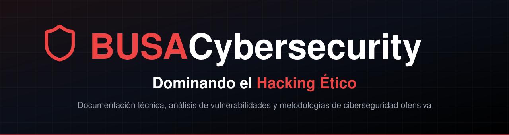
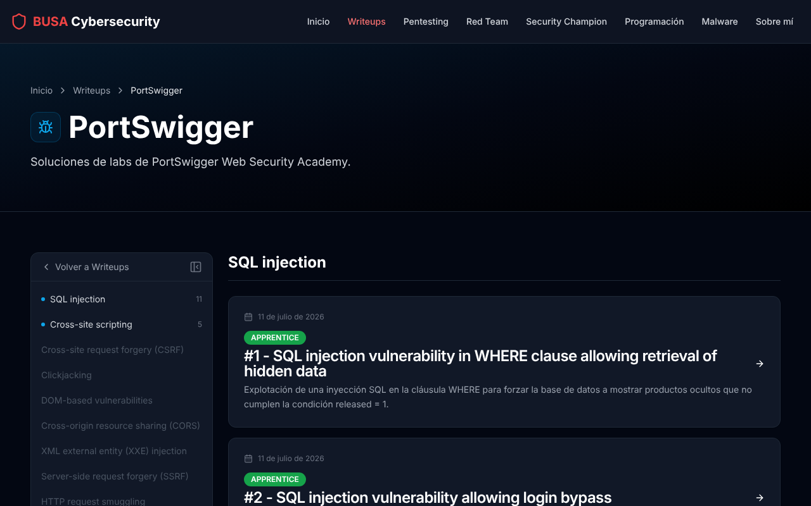

## Sobre el proyecto

**BUSA Cybersecurity** es mi base de conocimiento personal sobre hacking ético y ciberseguridad ofensiva. Aquí documento lo que aprendo y practico: resoluciones de laboratorios, técnicas de pentesting y Red Team, y, como diferencial, **cómo se corrigen las vulnerabilidades** que se explotan.

Soy Pedro Bustamante, ingeniero de software enfocado en pruebas de seguridad, remediación y AppSec. Este sitio es mi portafolio y mi cuaderno técnico a la vez.

> [!IMPORTANT]
> **Todo el contenido es educativo.** Las técnicas se practican únicamente en entornos autorizados: Hack The Box, TryHackMe, PortSwigger Web Security Academy y laboratorios propios. Nada de lo publicado debe usarse contra sistemas sin permiso explícito.

## Qué encontrarás

| Sección | Contenido |
| --- | --- |
| **Writeups** | Hack The Box, TryHackMe, PortSwigger Web Security Academy y cheatsheets |
| **Pentesting** | Seguridad web, Linux, Windows, Mobile y herramientas (Burp Suite, Nmap, Metasploit, John the Ripper) |
| **Red Team** | Evasión de defensas, persistencia, ingeniería social y Active Directory avanzado |
| **Security Champion** | Remediación, código seguro, SSDLC y DevSecOps, reportes de hallazgos y hardening |
| **Programación** | Python, Bash, PowerShell y Go aplicados a seguridad |
| **Malware** | Análisis, ingeniería inversa y técnicas de detección, con fines educativos |
| **Logros** | Certificaciones, diplomas y reconocimientos |
| **Sobre mí** | Perfil, experiencia y habilidades |

Algunas secciones todavía están en construcción: mientras no tienen artículos muestran un aviso con el color de su menú, y se activan solas cuando publico el primero.

## Enfoque

- **Atacar y también corregir.** Cada vulnerabilidad se estudia desde la explotación, pero también desde la causa raíz, el código vulnerable frente al corregido y cómo verificar el arreglo.
- **Documentación que se puede reutilizar.** Los writeups siguen una estructura clara para que sirvan de consulta rápida más adelante.
- **Aprendizaje continuo.** El contenido crece a la par de mis laboratorios, certificaciones y trabajo en seguridad.

## Hecho con

Next.js 15 · TypeScript · Tailwind CSS · shadcn/ui · MDX · Vercel

## Contacto

[GitHub](https://github.com/PedroSarasti) · [LinkedIn](https://www.linkedin.com/in/pedro-jose-bustamante-sarasti/) · [TryHackMe](https://tryhackme.com/p/PedrinhoX) · [Correo](mailto:pedrojbs1704@outlook.com)

---

## English summary

**BUSA Cybersecurity** is my personal knowledge base on ethical hacking: lab writeups (Hack The Box, TryHackMe, PortSwigger), pentesting and Red Team notes, and a *Security Champion* section focused on **remediation and secure coding**: root cause, vulnerable vs. fixed code, and how to verify the fix.

> [!IMPORTANT]
> All content is for educational purposes and practiced only in authorized environments.
