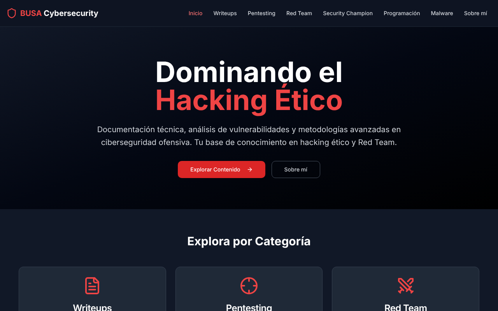

<div align="center">

# BUSA Cybersecurity

**Portafolio y base de conocimiento de hacking ético: writeups, pentesting, Red Team y remediación.**

[](https://busa-cybersecurity.vercel.app)




</div>

## Qué es

Sitio personal de **Pedro Bustamante** (ingeniero de software enfocado en ciberseguridad ofensiva y AppSec) donde documento lo que aprendo y practico: resoluciones de labs, técnicas de pentesting y Red Team, y, como diferencial, **cómo se corrigen las vulnerabilidades** que se explotan.

## Contenido

| Sección | Qué encontrarás |
| --- | --- |
| **Writeups** | Hack The Box, TryHackMe, PortSwigger Web Security Academy y cheatsheets |
| **Pentesting** | Seguridad web, Linux, Windows, Mobile y herramientas (Burp Suite, Nmap, Metasploit, John the Ripper) |
| **Red Team** | Evasión de defensas, persistencia, ingeniería social y Active Directory avanzado |
| **Security Champion** | Remediación, código seguro, SSDLC y DevSecOps, reportes de hallazgos y hardening |
| **Programación** | Python, Bash, PowerShell y Go aplicados a seguridad |
| **Malware** | Análisis, ingeniería inversa y técnicas de detección (con fines educativos) |
| **Logros** | Certificaciones, diplomas y reconocimientos |
| **Sobre mí** | Perfil, experiencia y habilidades |

Las secciones que aún no tienen artículos muestran una página de **"en construcción"** con el color de cada menú; desaparece sola cuando se publica el primer artículo.


## Cómo funciona

- **Contenido en MDX.** Cada artículo es un archivo `content/{sección}/{subsección}/{slug}.mdx` con frontmatter (título, descripción, fecha, tags, dificultad). Se lee con `gray-matter` y se renderiza con `next-mdx-remote`.
- **Sub-páginas.** Un archivo `{slug}__{subslug}.mdx` no aparece en los listados: se muestra como *Contenido relacionado* dentro del artículo principal (por ejemplo, el arreglo de un lab).
- **Navegación declarativa.** `lib/navigation.ts` es la única fuente de verdad de secciones, subsecciones, iconos y colores de acento. El menú, las páginas de sección y el sitemap se generan a partir de ahí.
- **Logros automáticos.** Basta con dejar el diploma en `public/certificados/<id>.png|jpg|webp|pdf` y la tarjeta del logro lo enlaza sola.
- **CV con código de acceso.** La descarga del CV pasa por `/api/cv`, que valida un código antes de entregar el archivo.

## Ejecutar en local

Requisitos: Node.js 18.18 o superior y [pnpm](https://pnpm.io).

```bash
git clone https://github.com/PedroSarasti/busa-cybersecurity-aq.git
cd busa-cybersecurity-aq
pnpm install
pnpm dev
```

Abre <http://localhost:3000>.

Variables de entorno (opcionales, en `.env.local`):

| Variable | Uso |
| --- | --- |
| `CV_ACCESS_CODE` | Código que se pide para descargar el CV desde `/api/cv` |

## Estructura

```text
app/            Rutas (App Router): secciones dinámicas, logros, sobre mí, API del CV
components/     UI (shadcn/ui), layout, tarjetas de logros, página "en construcción"
content/        Artículos MDX organizados por sección/subsección
lib/            Navegación, lectura de contenido, logros
public/         Imágenes y diplomas
docs/           Capturas usadas en este README
```

## Seguridad

- Dependencias revisadas con `pnpm audit` y Retire.js; Next.js actualizado a la última versión parcheada de la rama 15.
- Sin Server Actions ni middleware expuestos; rutas de contenido estáticas.
- Si encuentras algo que no debería estar público, escríbeme antes de publicarlo.

## Aviso

El contenido es **educativo**. Las técnicas documentadas se practican únicamente en entornos autorizados (Hack The Box, TryHackMe, PortSwigger Web Security Academy y laboratorios propios). No las uses contra sistemas sin permiso explícito.

## Contacto

[GitHub](https://github.com/PedroSarasti) · [LinkedIn](https://www.linkedin.com/in/pedro-jose-bustamante-sarasti/) · [TryHackMe](https://tryhackme.com/p/PedrinhoX) · [Correo](mailto:pedrojbs1704@outlook.com)

---

## English summary

**BUSA Cybersecurity** is my personal portfolio and knowledge base on ethical hacking, built with Next.js 15, TypeScript, Tailwind CSS and MDX, and deployed on Vercel. It publishes lab writeups (Hack The Box, TryHackMe, PortSwigger), pentesting and Red Team notes, and a *Security Champion* section focused on **remediation and secure coding**: root cause, vulnerable vs. fixed code, and how to verify the fix.

Content lives in `content/{section}/{subsection}/*.mdx`; sections, subsections and accent colors are driven by a single config file (`lib/navigation.ts`). To run it locally: `pnpm install && pnpm dev`.

All content is for educational purposes and practiced only in authorized environments.
